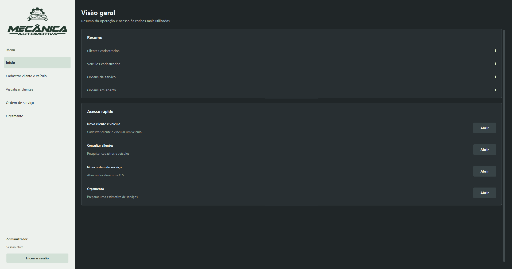

# Sistema para Oficina Mecânica

Aplicação desenvolvida em Python para gerenciamento de oficina mecênica, cadastro de veículos, clientes e ordens de serviço,
alterações, exclusões de cadastros e criação de PDF para orçamentos.

O sistema possui interface gráfica para interação com o usuário e utiliza banco de dados para o armazenamento de informações.

## Tecnologias usadas

- Python - Linguagem de programação
- TKinter - Desenvolimento da interface
- CustomTKinter - Modelos modernos para a interface
- SQLite - Banco de dados

# Funcionalidades

- Cadastro de clientes
- Cadastro de veículos
- Alteração de cadastro
- Exclusão de cadastro
- Ordens de serviço
- Geração de PDF para orçamentos
- Pesquisa de cadastros

## Interface gráfica

A imagem abaixo representa a tela inicial



## Pré-Requisitos

- Python
- Git
- SO compatível

## Instalação

### 1. Clone o repositório

Abra o terminal e execute:

```bash
git clone https://github.com/FilipeNonemacher/mecanica-automotiva.git
```

Acesse a pasta do projeto:

```bash
cd OficinaMecanica
```

### 2. Instale as Dependências

```bash
python -m pip install -r requeriments.txt
```